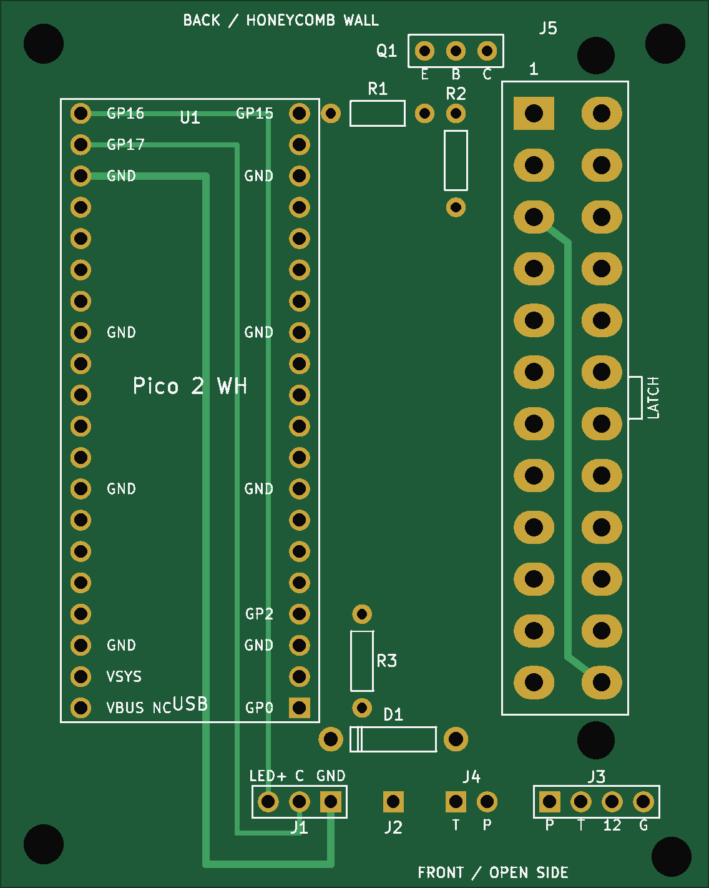
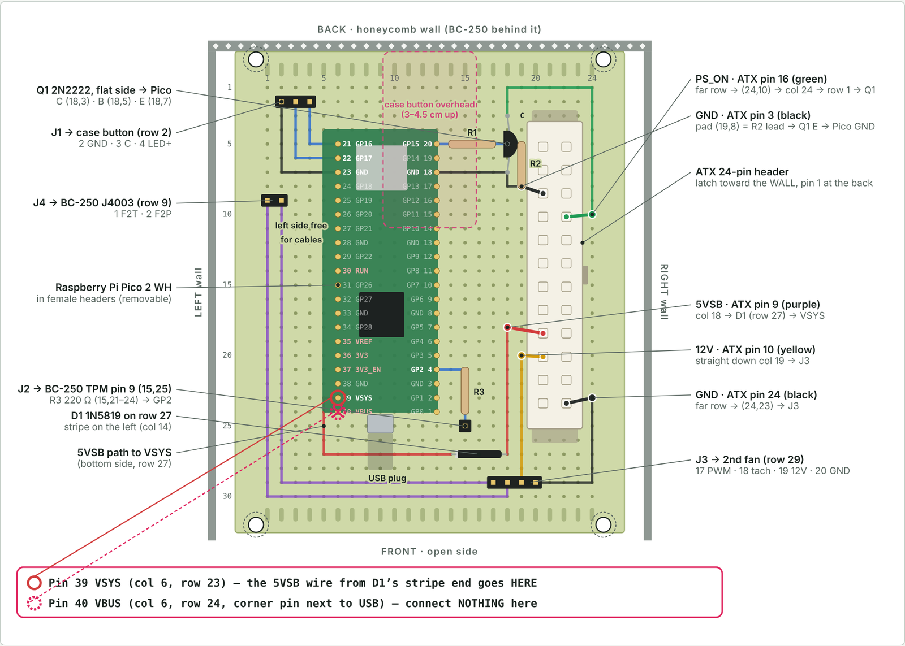

# BC-250 power controller

A small board that gives an AMD BC-250 (running SteamOS) a real power button and Bluetooth controller wake-up.
A Raspberry Pi Pico 2 W sits on the ATX power supply's 5 V standby rail and:

- **Case button** short press: PSU on (the BC-250 auto-boots) / clean SteamOS shutdown (USB power key)
- **Case button held 5 s:** force the PSU off
- **Wi-Fi (optional):** a phone page / home-screen icon (`http://bc250.local`): power on, shut down, your controllers
  with battery, pair new ones, forget old ones. **Home Assistant** via MQTT (separate firmware file). Set up from your phone in a minute.
  Wi-Fi runs only when you want it: on request (default), only while the console is off, always, or never
- **Low-battery warning:** the controller rumbles and the button LED blinks when a DualSense / DualShock is at 20 % or less
- **Case button held 8 s (console off):** Wi-Fi on for the phone page
- **Case button held 2 s:** pairing window, which accepts a new controller for 60 s. Outside it, controllers in
  pairing mode are ignored, so you can still pair yours with a phone or PC
- **Bluetooth controller** (DualSense, DS4, Switch Pro, Xbox, 8BitDo…): pressing PS / Xbox / Home wakes the board,
  and the controller is passed to the BC-250 over USB (as itself, or as an Xbox 360 pad)
- **TPM pin 9** of the BC-250 goes low after shutdown -> PSU off after 5 s
- **Button LED:** slow blink booting, solid running, fast blink shutting down
- **Second fan** powered from the PSU's 12 V, speed controlled by the BC-250 (J4003)

| Printed board (PCB v11) | Test board (perfboard) |
|---|---|
|  |  |

## Repository

| Folder | What |
|---|---|
| [`firmware/`](firmware/) | Pico 2 W firmware (C, Pico SDK 2.3.1 + Bluepad32). Ready-to-flash file in [`firmware/release/`](firmware/release/) |
| [`pcb/`](pcb/) | Printed board, v11 (and v9 Gerbers): KiCad project, Gerbers for JLCPCB / PCBWay / Aisler, notes |
| [`perfboard/`](perfboard/) | Test board on a 70×90 mm perfboard: hole-by-hole map |
| [`.github/workflows/`](.github/workflows/) | Automatic firmware build on GitHub; a version tag (`v8`) publishes a Release with both `.uf2` files |
| [`docs/`](docs/) | Build plan: wiring to the BC-250, Pico pins, SteamOS settings, mounting |
| [`CHANGELOG.md`](CHANGELOG.md) | Release notes: what's new, fixed and known issues in each firmware and PCB version |
| [`bom.csv`](bom.csv) | Parts list for both boards (opens in Excel; GitHub shows it as a table) |

## Quick start

1. **Flash:** hold BOOTSEL on the Pico, plug it into a PC, copy `firmware/release/bc250_power_v8.uf2` onto the `RP2350` drive
   (or `bc250_power_v8_ha.uf2` if you use Home Assistant).
2. **BC-250:** AUTO_PWRON jumper on pins 1–2; SteamOS `HandlePowerKey=poweroff`.
3. **Wire** per [`docs/build-plan.md`](docs/build-plan.md) (Pico GP15 -> PSU, GP17 <- button, GP16 -> LED, GP2 <- TPM pin 9).
4. **Pair a controller:** hold the case button 2 s and release (LED double-blinks), then put the controller in
   pairing mode within 60 s. Pairing turns the BC-250 on if it was off (expected).
5. **Optional Wi-Fi:** console off, hold the case button **8 s** (LED stays lit), release. On your phone tap the
   Wi-Fi **`BC250-setup`**; the setup page opens by itself. Pick your network, type its password, done. Then open
   `http://bc250.local` and *Add to Home Screen*. Wi-Fi switches itself off when unused (Settings → "Wi-Fi is on").

## Downsides and known limitations

**Testing status**
- **Firmware v8 compiles cleanly but hasn't been tested on real hardware yet** (v4 and v5 ran on the real board).
  Its web page was tested in a browser against a simulated Pico.
- **Wi-Fi and Bluetooth share one radio chip.** If controllers lag with Wi-Fi "Always", use "Only while the console
  is off" (Settings). Home Assistant only sees the BC-250 while Wi-Fi is on. Wi-Fi is 2.4 GHz only and adds a little standby power. Until a network is saved (or when it
  stays unreachable), the Pico runs the open setup Wi-Fi `BC250-setup`; someone nearby could set it up first.
  `bc250.local` doesn't open on some Android phones: use the Pico's address from your router. Without a PIN (`pin 1234`), anyone on your
  network can use the web page's buttons.
- **Battery level only for DualSense / DualShock**; Xbox, Switch Pro and 8BitDo don't report it to the Pico.
  Its key guard works around a Bluepad32 behaviour: after one failed reconnect Bluepad32 deletes the controller's
  pairing key, which made controllers "search" forever until re-paired. The Bluetooth repair from v5 stays for
  real radio hangs. The log (`sudo cat /dev/ttyACM0`) shows which one happened.
- **Controllers paired before v6 aren't protected until their first successful connection with v6.** If one
  already lost its key, re-pair it once.
- **Bluetooth repair takes a moment:** when Bluetooth is stuck, the Pico notices within about 30 s and restarts
  only Bluetooth, which takes a few more seconds. Until then, PS doesn't reconnect.
- **The log port only exists while no controller is connected**, so controller identities stay exact.
- **PCB v9 and v11 were checked with KiCad DRC, not on a built board. They differ only in the ATX pin order:** v9 follows the official
  connector footprint (pin 1 at the front), v11 has pin 1 at the back. Do the purple-wire check in [`pcb/README.md`](pcb/README.md) before ordering.
  Check the first board with a multimeter before connecting the PSU (see [`pcb/README.md`](pcb/README.md)).
- **The perfboard map (v16) has the ATX pin order of PCB v10 / v11 (pin 1 at the back).** Wire it by wire colour, not by the hole numbers.

**Controllers**
- **Whenever a controller joins or leaves, every controller drops for about 0.5 s.** The Pico re-plugs itself on USB
  with the new layout, and Steam may reassign player numbers.
- **Several real DualSense / DS4 / Switch Pro controllers inside one USB device is unusual.** Linux supports it,
  but Steam may show only one of them. Mixed groups fall back to Xbox 360 pads, which lose the touchpad, gyro,
  lightbar and adaptive triggers.
- **No audio:** the DualSense / DS4 headphone jack, speaker and mic aren't passed through.
- **Up to 4 controllers. Only Bluetooth ones work**: no wired controllers through the Pico, and no non-Bluetooth Xbox One pads.
- **New controllers only pair while the pairing window is open** (case button held 2 s). Bluetooth LE controllers
  already bonded to the Pico (e.g. Xbox) are still taken when put in pairing mode, because they reconnect the same way.
- **Pairing a controller turns the BC-250 on.** For 20 s after a shutdown, controllers that reconnect are ignored,
  so a quick press of PS right after power-off does nothing.

**Power and shutdown**
- **The shutdown key is a USB "Power" key.** SteamOS has to be set to `HandlePowerKey=poweroff`. Gaming mode or an
  inhibitor can swallow it; then press again, or hold 5 s.
- **Holding the button for 5 s cuts power hard,** with no clean shutdown, like pulling the plug.
- **A short press while the board is booting is ignored.**
- **"Off" is detected from TPM header pin 9.** If the board doesn't boot within 180 s, the PSU is switched off again.
- **When a controller identity is active, the power key needs a ~2 s USB re-plug first.** The controllers vanish from
  SteamOS at that moment, which doesn't matter because it's shutting down.

**Hardware**
- **The Pico is always powered from the PSU's 5 V standby rail,** with its Bluetooth radio on, so the PC draws a little more
  power while "off".
- **With a normal USB cable, a little standby power can leak into the switched-off BC-250** through the Pico's
  internal diode (its back-panel LEDs may glow faintly). The clean fix is a cable with the red 5 V wire cut, plus
  `USE_VBUS_SENSE 0` in `firmware/src/config.h`.
- **Specific to the BC-250 and an ATX PSU** (needs AUTO_PWRON, the TPM header and J4003). Other boards need new pin mapping and logic.
- **No Wi-Fi features** (no web page or remote power-on over the network).

## ⚠️ Safety notes

- **ATX header orientation:** the two pin rows are **5.5 mm apart** (PCB v1–v8 used 4.2 mm: never use them).
  KiCad's official footprint puts pin 1 at the FRONT end with the latch facing the wall (PCB v9); PCB v10 / v11 put it at the BACK.
  Only one matches your connector, and the wrong one puts 12 V on GND: check with the PSU cable first (see [`pcb/README.md`](pcb/README.md)).
- **Pico VBUS (pin 40) stays unconnected** on the board. The USB cable's 5 V (red wire) can leak standby power into a
  switched-off BC-250; firmware v4 and later handle a normal cable (`USE_VBUS_SENSE 1`).

## Versions

| | Version | Date |
|---|---|---|
| Firmware | v8 – Wi-Fi phone page (setup from the phone, controller list, pairing, forget) + Home Assistant, low-battery warning, pairing window, key guard, Bluetooth repair, event log | 2026-11-06 |
| PCB | v11 – gaps between the front headers; ATX pin 1 at the back (v9: pin 1 at the front); 5.5 mm rows, peg holes | 2026-11-06 |
| Perfboard map | v16 (ATX pin order as PCB v10 / v11; wire it by wire colour) | 2026-10-18 |

**Building:** `bash firmware/build.sh` (library versions pinned in `firmware/deps.env`), or download the `.uf2` from
GitHub (Actions / Releases).

**Release notes for every version:** [`CHANGELOG.md`](CHANGELOG.md). Technical details: [`firmware/README.md`](firmware/README.md), [`pcb/README.md`](pcb/README.md).
