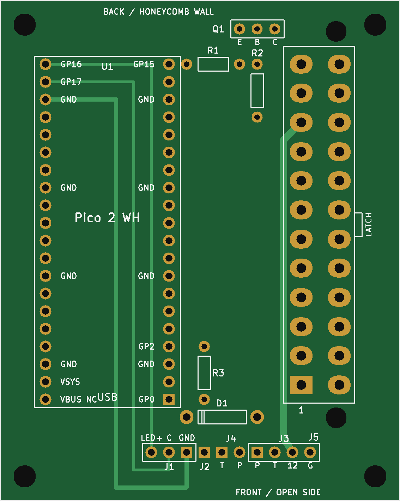
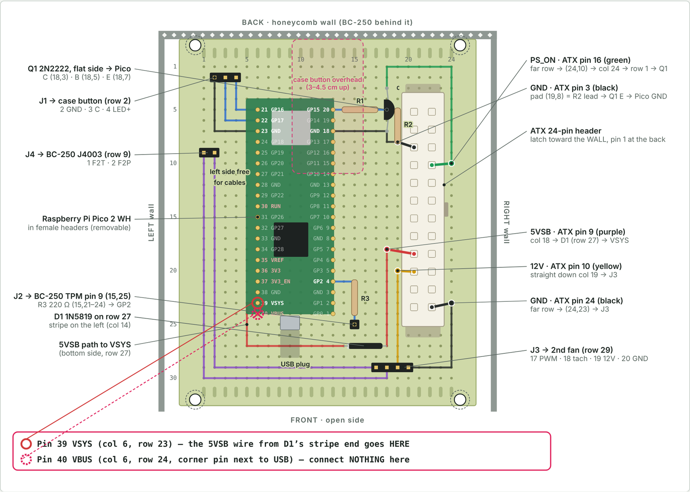

# BC-250 power controller

A small board that gives an AMD BC-250 (running SteamOS) a real power button and Bluetooth controller wake-up.
A Raspberry Pi Pico 2 W sits on the ATX power supply's 5 V standby rail and:

- **Case button** short press: PSU on (the BC-250 auto-boots) / clean SteamOS shutdown (USB power key)
- **Case button held 5 s:** force the PSU off
- **Bluetooth controller** (DualSense, DS4, Switch Pro, Xbox, 8BitDo…): pressing PS / Xbox / Home wakes the board,
  and the controller is passed to the BC-250 over USB (as itself, or as an Xbox 360 pad)
- **TPM pin 9** of the BC-250 goes low after shutdown -> PSU off after 5 s
- **Button LED:** slow blink booting, solid running, fast blink shutting down
- **Second fan** powered from the PSU's 12 V, speed controlled by the BC-250 (J4003)

| Printed board (PCB v9) | Test board (perfboard) |
|---|---|
|  |  |

## Repository

| Folder | What |
|---|---|
| [`firmware/`](firmware/) | Pico 2 W firmware (C, Pico SDK 2.3.1 + Bluepad32). Ready-to-flash file in [`firmware/release/`](firmware/release/) |
| [`pcb/`](pcb/) | Printed board, v9: KiCad project, Gerbers for JLCPCB / PCBWay / Aisler, notes |
| [`perfboard/`](perfboard/) | Test board on a 70×90 mm perfboard: hole-by-hole map |
| [`docs/`](docs/) | Build plan: wiring to the BC-250, Pico pins, SteamOS settings, mounting |
| [`bom.csv`](bom.csv) | Parts list for both boards (opens in Excel; GitHub shows it as a table) |

## Quick start

1. **Flash:** hold BOOTSEL on the Pico, plug it into a PC, copy `firmware/release/bc250_power_v4.uf2` onto the `RP2350` drive.
2. **BC-250:** AUTO_PWRON jumper on pins 1–2; SteamOS `HandlePowerKey=poweroff`.
3. **Wire** per [`docs/build-plan.md`](docs/build-plan.md) (Pico GP15 -> PSU, GP17 <- button, GP16 -> LED, GP2 <- TPM pin 9).
4. **Pair a controller:** put it in pairing mode. Pairing turns the BC-250 on (expected).

## ⚠️ Safety notes

- **ATX header orientation:** with the latch facing the wall, **pin 1 is at the FRONT end**, and the two pin rows are **5.5 mm apart**.
  PCB versions v1–v8 and perfboard map v16 had this mirrored (12 V on GND). Only use **PCB v9 or later**.
- **Pico VBUS (pin 40) stays unconnected** on the board. The USB cable's 5 V (red wire) can leak standby power into a
  switched-off BC-250; firmware v4 handles a normal cable (`USE_VBUS_SENSE 1`).

## Versions

| | Version | Date |
|---|---|---|
| Firmware | v4 – Bluetooth self-healing (restarts the Pico if Bluetooth stops answering, PSU off only) | 2026-10-20 |
| PCB | v9 – corrected ATX header (5.5 mm rows, pin 1 at the front, peg holes) | 2026-10-19 |
| Perfboard map | v16 (ATX header superseded by PCB v9) | 2026-10-18 |

Full change history: [`firmware/README.md`](firmware/README.md), [`pcb/README.md`](pcb/README.md).
