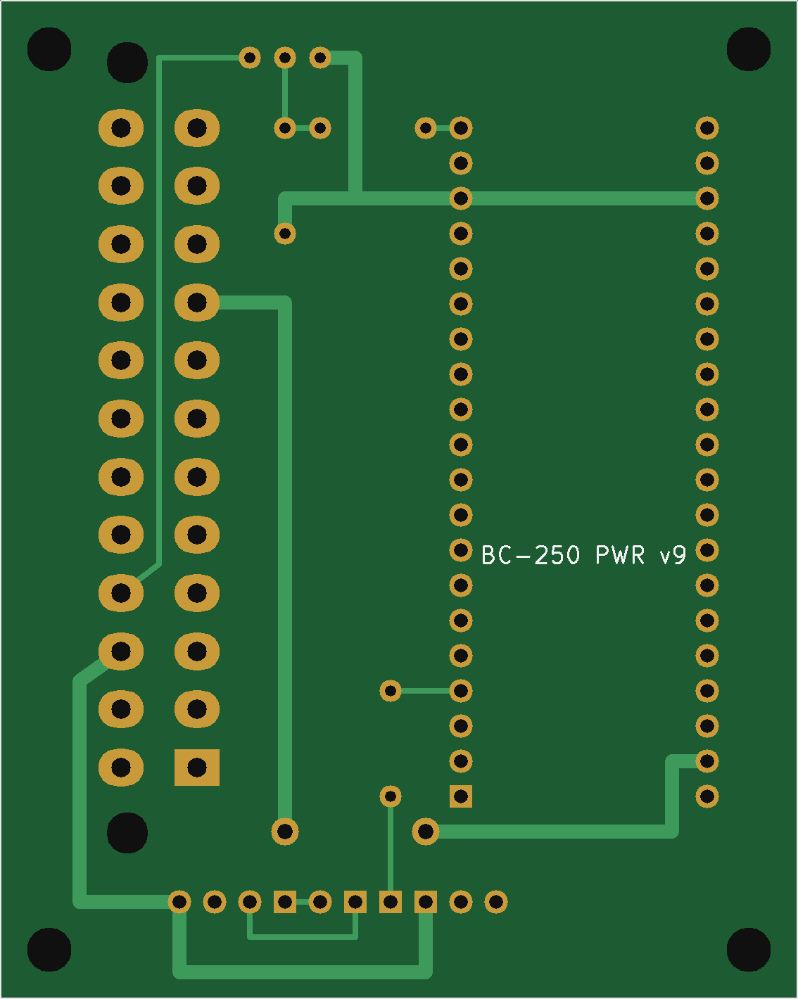
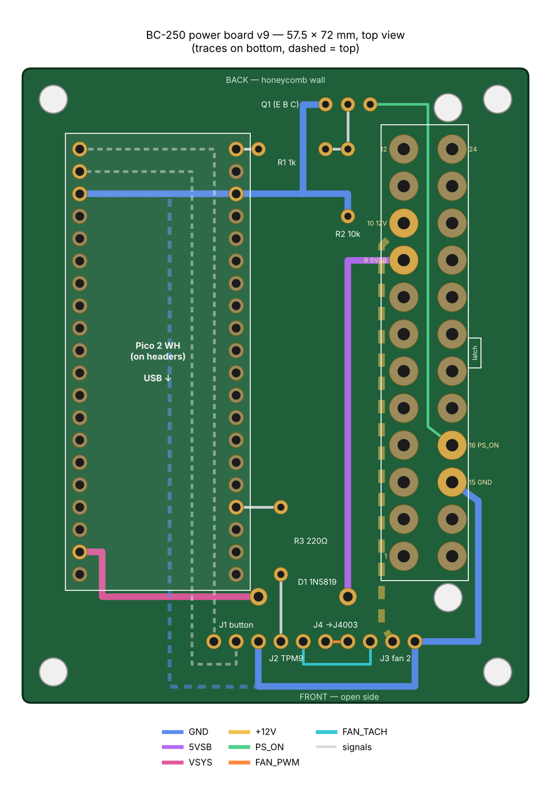

# Printed board – PCB v9

| | |
|---|---|
| **Top** (component side, rendered from the Gerbers) | **Bottom** (seen from below) |
|  |  |

**Wiring diagram** (colour-coded nets, dashed = top layer):

## Files
| File | What |
|---|---|
| [`gerbers/bc250_power_gerbers_v9.zip`](gerbers/bc250_power_gerbers_v9.zip) | Upload this to the board maker |
| [`kicad/`](kicad/) | KiCad 7+ project (`bc250_power.kicad_pro` / `.kicad_pcb`), `gen_board.py` (generates the board), `check_board.py` (clearance / connectivity check) |
| [`images/`](images/) | The pictures on this page |

Never use Gerbers from v1–v8: their ATX header is mirrored (12 V on GND) and its rows are 4.2 mm apart.
How to tell: v9's drill file has two **3.0 mm** peg holes and the 1.4 mm ATX holes in two columns **5.5 mm** apart.

- Board 57.5 × 72 mm, 2 layers, 1.6 mm. 4 × M3 holes (3.2 mm) at 3.5 mm from each corner.
- Grid: hole (col 6, row 1) at x 6.5, y −1.0 mm; 2.54 mm pitch. Derived from perfboard map v16.

## Ordering
Upload `gerbers/bc250_power_gerbers_v9.zip` to JLCPCB / PCBWay / Aisler: 2 layers, 1.6 mm, defaults for everything else.

## v9 (19 Oct 2026) – ATX header fixed
Checked against KiCad's official Molex_Mini-Fit_Jr_5566-24A2 footprint: all 24 pins and both pegs match exactly.
- Rows of the Mini-Fit Jr header are **5.5 mm apart** (v1–v8 wrongly used 4.2 mm). Pads 3.3 × 2.7 mm oval, 1.4 mm drill.
- Added the two **3.0 mm holes for the snap-in pegs**, on the wall-side row line, 4.7 mm beyond each end pin.
- **Pin order flipped:** with the latch facing the wall, pins 13–24 are on the wall side and **pin 1 is at the FRONT end, pin 12 / 24 at the back**.
- Used ATX pins: 9 5VSB, 10 +12V (Pico-side row, back half), 16 PS_ON and 15 GND (wall-side row, front half).
- Routing: PS_ON runs from pin 16 up the channel between the two pin rows to Q1's collector. 5VSB goes from pin 9 along the bottom to col 18 and down to D1. +12V runs on the top layer from pin 10 along x 40.8 mm to J3 pin 3. GND: pin 15 → lane beside the wall row (x 51.8) → J3 pin 4 → bottom row 29 → J1 GND → top trace → Pico GND (pins 23/18) → row 7 → R2 and Q1 E.
- R2 10k moved to col 18 (row 5 base → row 8 GND) so it doesn't touch the connector body.
- Board widened 2 mm (55.5 → 57.5) so the GND lane and the right-hand screws clear the connector.
- Placement: latch tip is 5.4 mm inside the board's right edge.

## Layout (unchanged since v5)
- Q1 2N2222 flat on row 3 (E col 17, B col 18, C col 19). R1 1k row 5 (col 14 → 17). R3, D1 (row 25, K col 14, A col 18), VSYS row 25 → col 7 → Pico pin 39.
- Front header row (row 27), left to right: J1 button (cols 12–14: LED+, C, GND), J2 TPM9 (col 15), J4 → BC-250 J4003 (cols 16 T, 17 P), J3 fan 2 (cols 18–21: PWM, TACH, 12V, GND).
- Pico on cols 6/13 rows 5–24; VBUS (pin 40) unconnected.
- Trace widths: 1.0 mm for GND / 5VSB / VSYS / 12V, 0.4–0.6 mm for signals.

## Before first power-up
Plug the PSU cable into the soldered header (PSU off): the purple wire must sit on the pad marked 9, yellow on 10,
green on 16, black on 15. With the PSU on mains but off, pad 9 must read +5 V to GND.

## Checks
KiCad DRC: 0 electrical errors, 0 unconnected pads. Independent clearance/connectivity script: 0 errors.
Footprint compared pin-by-pin with the official KiCad footprint.

## History
- v2 (18 Oct): cut the free left strip; PS_ON / fan-GND lane moved closer to the header.
- v3: J1 moved from the back edge to the front, away from the button body.
- v4: all cable headers in one row at the front edge.
- v5: J2 (TPM) joins the front header row.
- v6–v8: layout tweaks (superseded – mirrored ATX header).
- v9 (19 Oct): ATX header corrected (see above).
