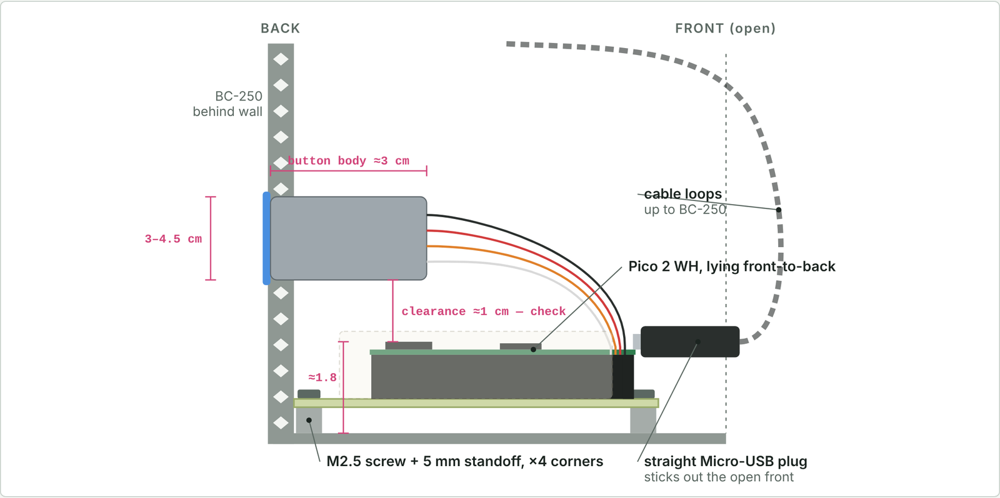

# Test board – perfboard map v16

> ⚠️ **The ATX header in this map is mirrored end-to-end.** Checked against KiCad's official Molex 5566-24A2 footprint:
> with the latch facing the wall, **pin 1 is at the FRONT end** (pins 12/24 at the back), and the two rows are **5.5 mm apart**, not 4.2 mm.
> A perfboard wired exactly per this map would put 12 V on the GND traces. If you build one, wire the ATX pins by
> **wire colour** (purple 5VSB, yellow 12V, green PS_ON, black GND), not by the hole positions below.
> The PCB in [`../pcb/`](../pcb/) (v9) is correct.

## Drawings

**Top view (component side)**: coloured lines are solder paths on the bottom.
The ATX pin numbers in this drawing follow the old mirrored layout; trust the wire colours.

**Side section (looking from the left wall)**: button height over the Pico.

The interactive version with the full wiring list is [`layout.html`](layout.html). Download it and open it in a browser.

## Map

Board: full 70×90 double-sided perfboard = 24 columns (left–right) × 30 rows (front–back), top view as installed.
Row 1 = back (honeycomb wall). Row 30 = front (open side). Col 24 = right (ATX side).
Left side (cols 1–5) kept free on top for the BC-250 PCIe/Molex cables. Keep the USB plug area (cols ~8–11, rows 25–28) clear on top.

## Parts

| Part | Holes | Note |
|---|---|---|
| Pico female headers | cols 6 and 13, rows 5–24 | USB at the front end. Col 6 rows 5→24 = pins 21→40; col 13 rows 5→24 = pins 20→1 |
| ATX 24-pin header | right edge, centre ≈ col 21.4, rows ~2.6–26.2 incl. end ears | latch faces the WALL (~1 cm clearance). **Pin order and row pitch: see warning above** |
| J1 button | row 2, cols 2–4 | 2 GND (NO + LED− joined at the button), 3 C, 4 LED+ |
| Q1 2N2222 | C(18,3) B(18,5) E(18,7) | flat side toward the Pico |
| R1 1 kΩ | (14,5)–(17,5) | GP15 → base |
| R2 10 kΩ | (19,5)–(19,8) | base ↔ emitter; next to the ATX header edge |
| R3 220 Ω | (15,21)–(15,24) | TPM → GP2 |
| J2 TPM | (15,25), 1 pin | TPM pin 9 only |
| D1 1N5819 | row 27, anode (18,27) → cathode/stripe (14,27) | |
| J4 → BC-250 J4003 | row 9, cols 1–2 | 1 tach → F2T, 2 PWM → F2P |
| J3 second fan | row 29, cols 17–20 | 17 PWM, 18 tach, 19 12V, 20 GND |

## ATX wires (bottom side)
By function (positions as in v16, **check against the PSU cable colours**):
- GND (black) → pad (19,8) (= R2 lower lead)
- 5VSB, pin 9 (purple) → pad (18,18)
- 12V, pin 10 (yellow) → pad (19,20)
- PS_ON, pin 16 (green) → short link → (24,10)
- GND (black) → short link → (24,23)

## Bottom solder paths
- J1: (4,2)→(4,5)→(6,5) GP16 LED+; (3,2)→(3,6)→(6,6) GP17 C; (2,2)→(2,7)→(6,7) GND
- GND: (19,8)→(18,8)→(18,7) Q1 E; E (18,7)→(13,7) Pico GND (straight row 7)
- Base: (13,5)→(14,5) R1 (17,5)→(18,5) B →(19,5) R2
- PS_ON: (24,10)→(24,1)→(18,1)→(18,3) C
- 5VSB: (18,18)→(18,27) D1 (14,27)→(5,27)→(5,23)→(6,23) VSYS
- 12V: (19,20)→(19,29) J3 (straight)
- Fan GND: (24,23)→(24,29)→(20,29) J3; PWM (17,29)→(2,29)→(2,9) J4; tach (18,29)→(18,30)→(1,30)→(1,9) J4
- J2: (13,21)→(15,21) R3 (15,24)→(15,25) J2

Pico VSYS = pin 39 = hole (6,23). VBUS = pin 40 = hole (6,24): leave EMPTY.
